# Heart Disease Prediction — End-to-End MLOps Pipeline

## 1. Project Overview

This project implements an end-to-end Machine Learning Operations (MLOps) pipeline for predicting the presence of heart disease using patient clinical attributes.

The project covers data exploration, preprocessing, model training and evaluation, experiment tracking, API deployment, containerization, Kubernetes orchestration, automated testing, continuous integration, and application monitoring.

**Technologies:** Python 3.11, Pandas, NumPy, Scikit-learn, MLflow, FastAPI, Docker, Kubernetes, Pytest, Ruff, and GitHub Actions.

> **Disclaimer:** This application is an educational machine learning demonstration and is not intended for clinical diagnosis or medical decision-making.

## 2. Dataset

**Source:** UCI Machine Learning Repository — Heart Disease Dataset (Processed Cleveland).

- Total records: 303
- Input features: 13
- Target: `num`
- Prediction type: Binary classification

The original target contains values from 0 to 4. It is converted into:

- `0`: No heart disease
- `1`: Heart disease present (original target greater than 0)

The input features include age, sex, chest pain type, resting blood pressure, cholesterol, fasting blood sugar, resting ECG results, maximum heart rate, exercise-induced angina, ST depression, slope, number of major vessels, and thalassemia test result.

Dataset file: `data/heart_disease_raw.csv`

## 3. Exploratory Data Analysis

EDA was performed using Python and Jupyter Notebook to understand the dataset.

The analysis includes:

- Target class distribution
- Feature distributions
- Correlation heatmap
- Missing-value analysis
- Exploration of numerical and categorical variables

Notebook: `notebooks/01_eda.ipynb`

### EDA Visualizations

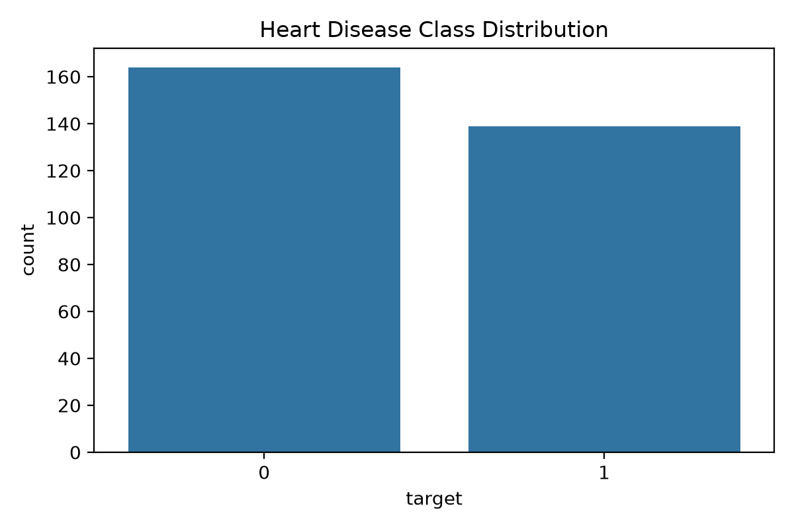

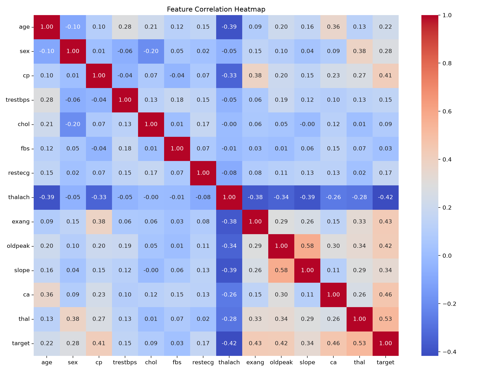

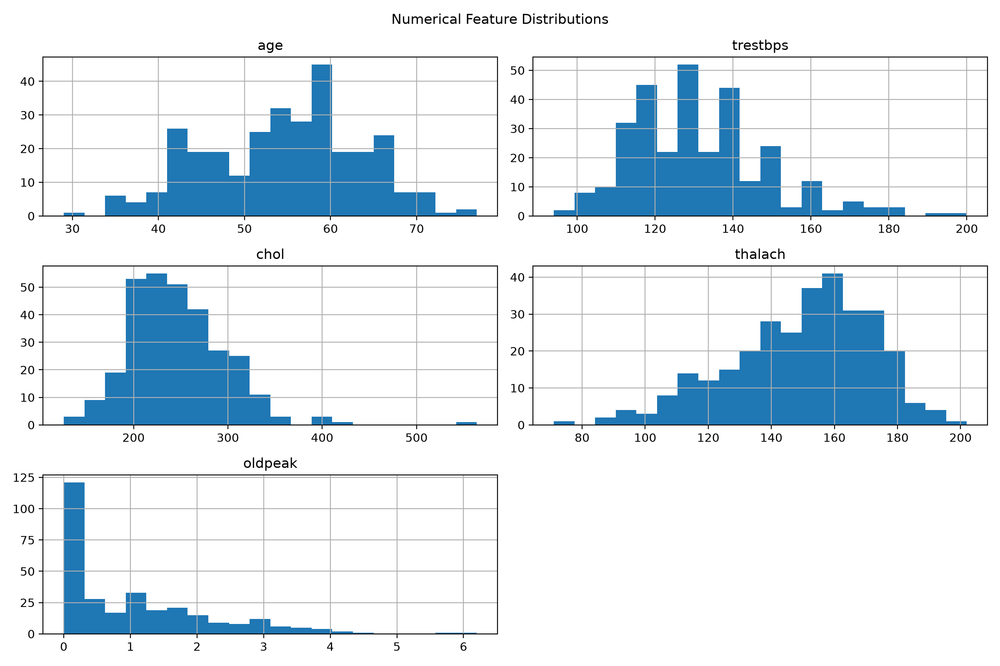

## 4. Data Preprocessing

The preprocessing pipeline uses Scikit-learn transformers to prepare the dataset for model training.

**Numerical features:**
- Missing values are imputed using the median.
- Features are standardized using scaling.

**Categorical features:**
- Missing values are imputed using the most frequent value.
- Categories are encoded using one-hot encoding.

The preprocessing steps are incorporated into the machine learning pipeline to support consistent training and inference.

Implementation: `src/data_processing.py`

## 5. Model Training and Hyperparameter Tuning

Two machine learning algorithms were trained and evaluated:

1. Logistic Regression
2. Random Forest Classifier

Hyperparameter optimization was performed using `GridSearchCV` with five-fold cross-validation.

### Cross-Validation Results

| Model | CV Accuracy | CV Precision | CV Recall | CV ROC-AUC |
|---|---:|---:|---:|---:|
| Logistic Regression | 84.71% | 87.68% | 78.34% | 90.25% |
| Random Forest | 81.81% | 81.73% | 78.26% | 89.72% |

**Best recorded hyperparameters:**

- Logistic Regression: `C=1.0`
- Random Forest: `max_depth=None`, `n_estimators=100`

Logistic Regression achieved the higher cross-validation ROC-AUC.

### Saved Model Test Results

| Metric | Score |
|---|---:|
| Accuracy | 88.52% |
| Precision | 83.87% |
| Recall | 92.86% |
| ROC-AUC | 96.65% |

Saved model: `models/best_model.joblib`

Evaluation files:
- `models/test_metrics.json`
- `models/model_comparison.csv`

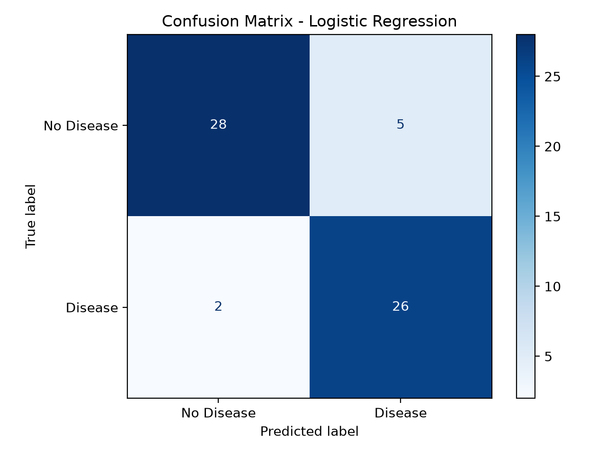

## 6. MLflow Experiment Tracking

MLflow was used to track model training experiments and compare results.

Tracked information includes:

- Model parameters
- Cross-validation and evaluation metrics
- Training runs
- Model artifacts

Run the MLflow interface locally:

```bash
mlflow ui
```

Open `http://127.0.0.1:5000` to inspect available experiments.

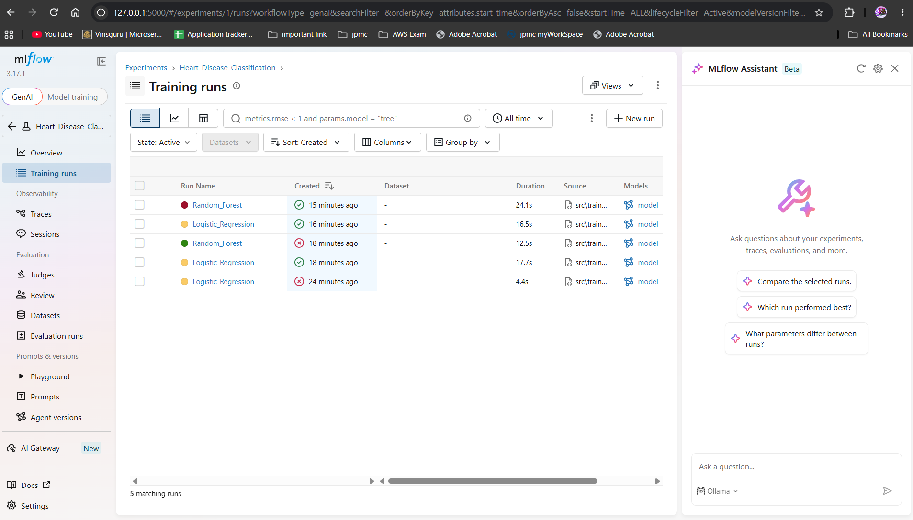

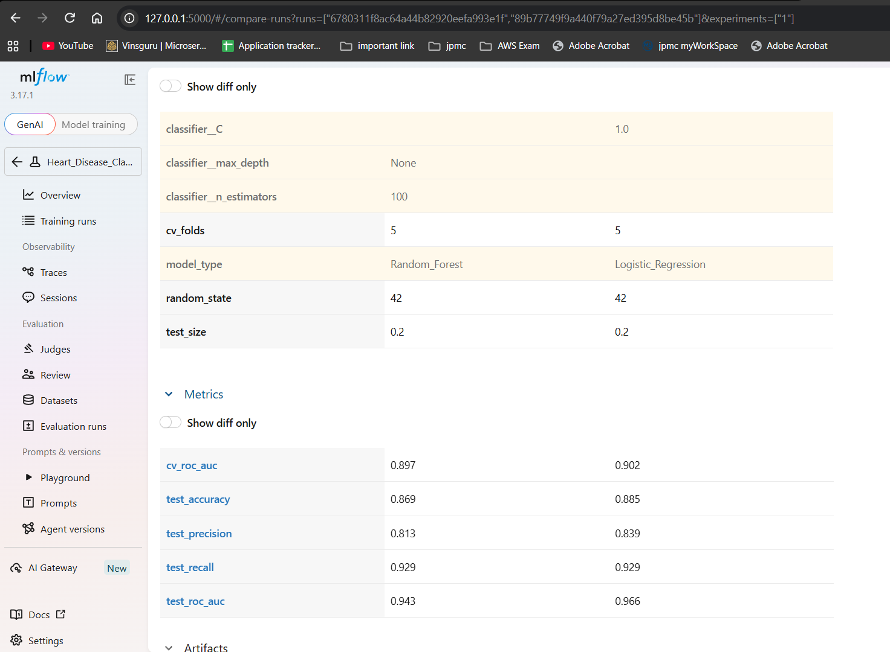

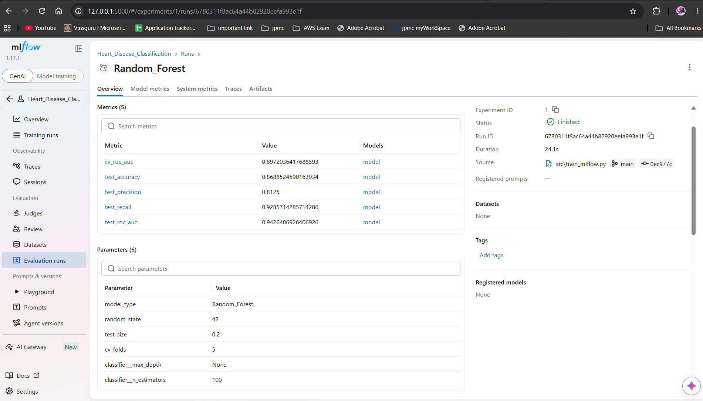

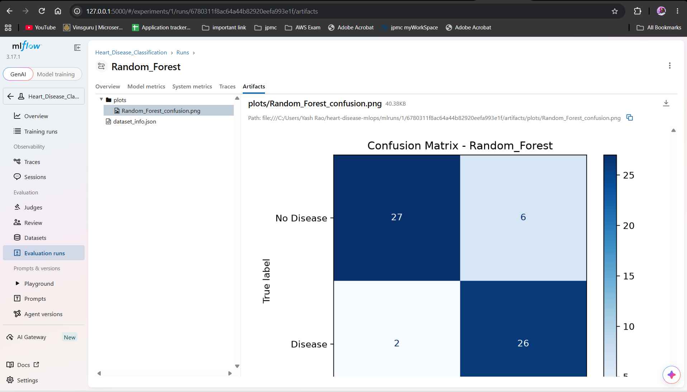

## 7. FastAPI Model Serving

The trained model is exposed through a REST API implemented with FastAPI.

### Available Endpoints

| Method | Endpoint | Description |
|---|---|---|
| GET | `/` | API information |
| GET | `/health` | Application and model health check |
| POST | `/predict` | Predict heart disease presence |
| GET | `/docs` | Interactive Swagger documentation |

### Run Locally

Install the project dependencies:

```bash
python -m pip install -r requirements.txt
```

Start the API:

```bash
python -m uvicorn src.api:app --host 127.0.0.1 --port 8000
```

Open `http://127.0.0.1:8000/docs`.

### Example Prediction Request

```json
{
  "age": 54,
  "sex": 1,
  "cp": 4,
  "trestbps": 130,
  "chol": 246,
  "fbs": 0,
  "restecg": 2,
  "thalach": 150,
  "exang": 1,
  "oldpeak": 1.5,
  "slope": 2,
  "ca": 0,
  "thal": 3
}
```

The API returns a predicted class, class label, confidence score, and heart disease probability.

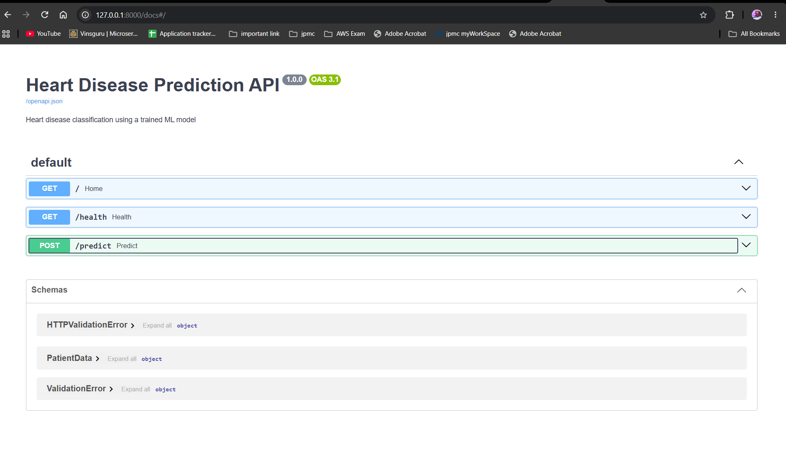

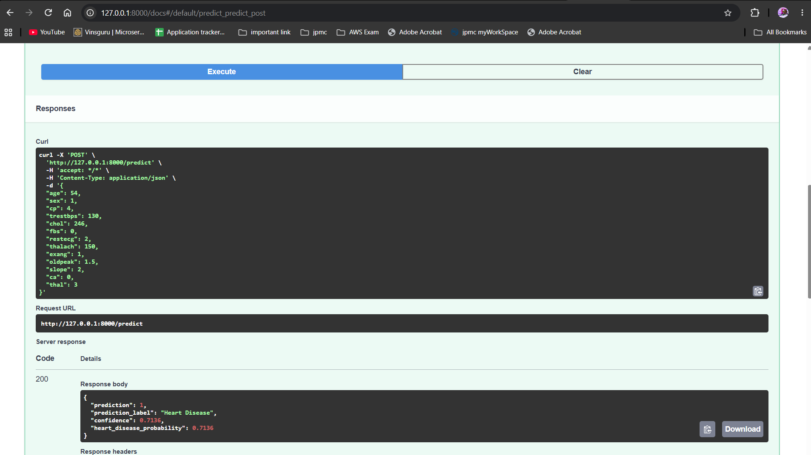

## 8. Docker Containerization

The FastAPI application and saved model are packaged into a Docker image.

Build the application image:

```bash
docker build -t heart-disease-api:v2 .
```

Run the container:

```bash
docker run --rm -p 8000:8000 heart-disease-api:v2
```

Access the API at `http://127.0.0.1:8000/docs`.

The container uses Python 3.11 and runs the application as a non-root user.

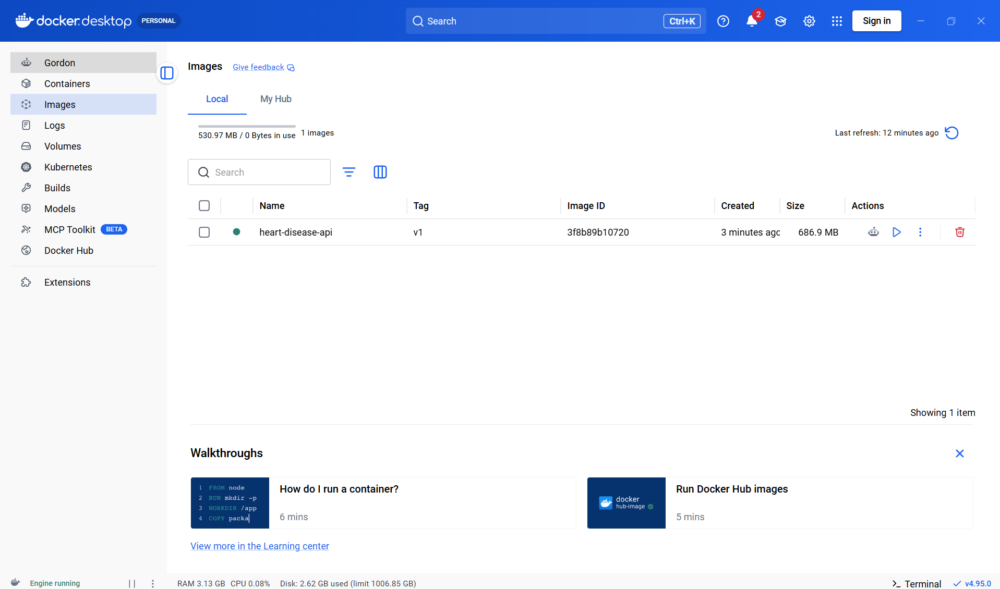

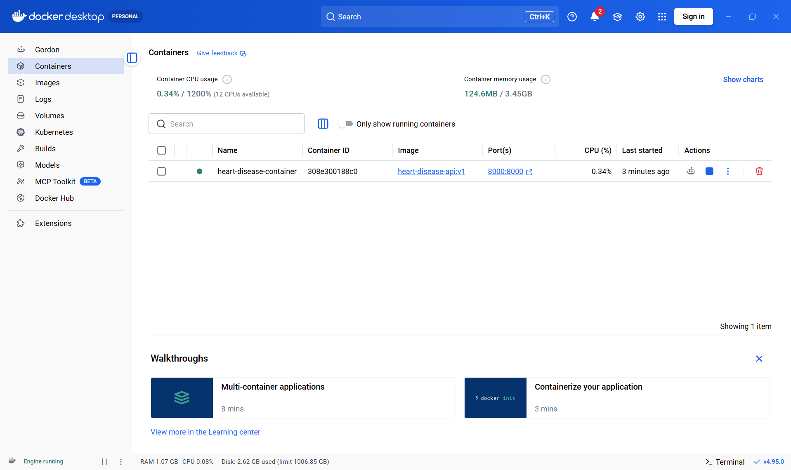


## 9. Kubernetes Deployment

The application is deployed to a local Kubernetes cluster using Docker Desktop.

Kubernetes resources include:

- Deployment: `heart-disease-api`
- Service: `heart-disease-service`
- Container image: `heart-disease-api:v2`
- Application port: `8000`
- Readiness and liveness probes: `/health`

Deploy the application:

```bash
kubectl apply -f k8s/deployment.yaml
kubectl apply -f k8s/service.yaml
```

Verify deployment status:

```bash
kubectl get deployments
kubectl get pods
kubectl get services
```

Expose the service locally:

```bash
kubectl port-forward service/heart-disease-service 8002:8000
```

Open `http://127.0.0.1:8002/docs`.

**Note:** The Kubernetes manifest uses `imagePullPolicy: Never`. The Docker image must already be available to the local Kubernetes cluster.

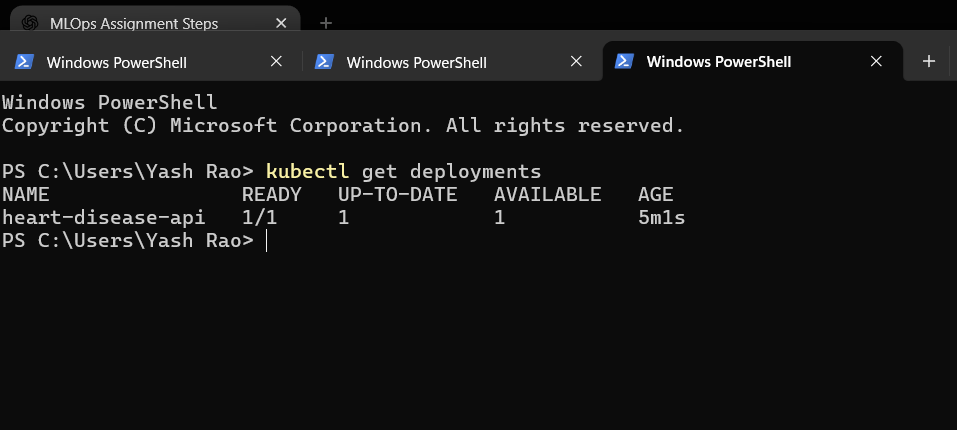

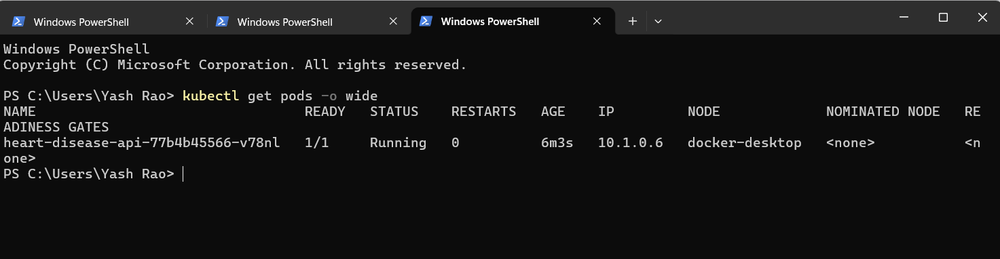

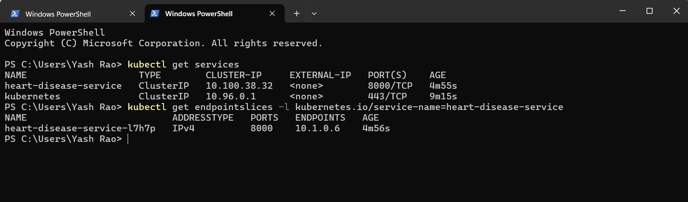

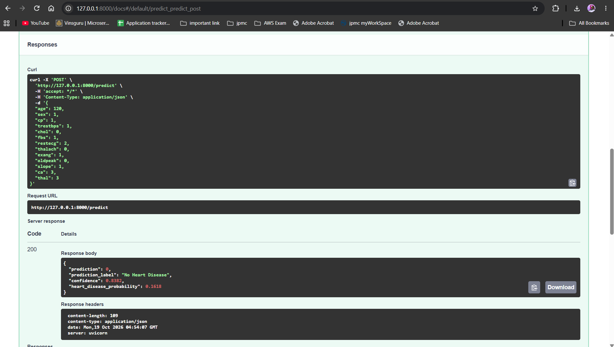

## 10. Automated Testing

Automated testing is implemented using Pytest.

The test suite contains nine tests covering:

- API health endpoint
- Prediction endpoint
- Invalid input validation
- Missing required features
- Feature count validation
- Missing-value preprocessing
- Saved model availability
- Model predictions
- Probability outputs

Run the tests:

```bash
python -m pytest tests/ -v
```

**Result: 9 tests passed.**

Run code quality checks:

```bash
python -m ruff check src/ tests/ --select E4,E7,E9,F63,F7,F82
```

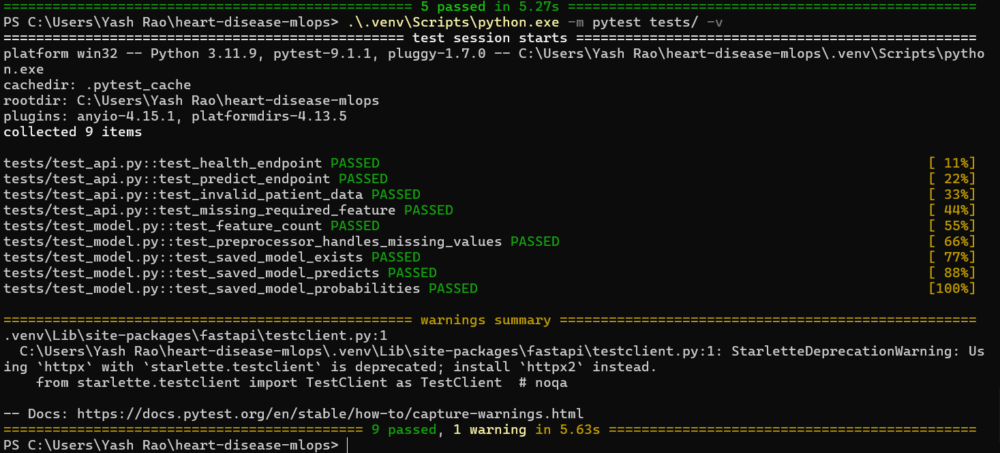

## 11. Continuous Integration with GitHub Actions

GitHub Actions automatically runs the CI workflow on repository pushes and pull requests.

Workflow file: `.github/workflows/ci.yml`

The CI pipeline performs:

1. Repository checkout
2. Python 3.11 setup
3. Dependency installation
4. Dataset and model verification
5. Ruff code quality checks
6. Automated Pytest execution

The pipeline has been verified with a successful GitHub Actions run.

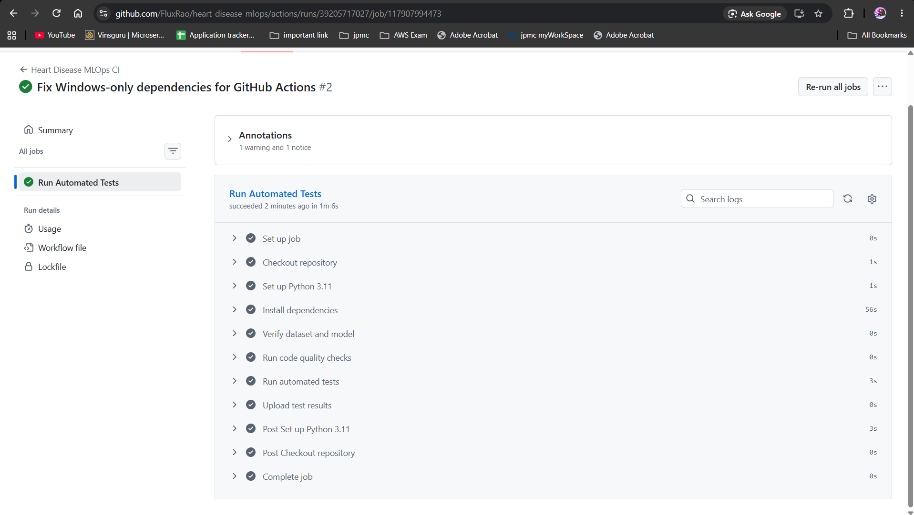

## 12. Logging and Monitoring

The API includes request logging middleware to capture:

- Request timestamp
- HTTP method
- Request endpoint
- HTTP response status
- Request duration in milliseconds

Application startup and prediction errors are also logged.

The middleware does not log complete patient request bodies or clinical feature values.

Example log:

```text
Request completed | method=POST | path=/predict | status=200 | duration_ms=410.31
```

Inspect logs in Kubernetes:

```bash
kubectl logs deployment/heart-disease-api --tail=100
```

Kubernetes readiness and liveness probes periodically check the `/health` endpoint.

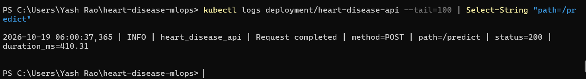

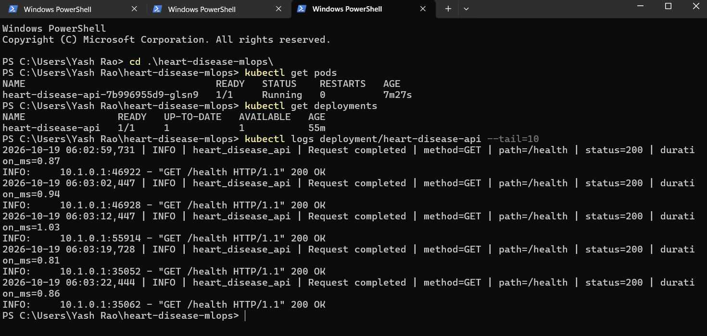

## 13. Project Structure

```text
heart-disease-mlops/
├── .github/
│   └── workflows/
│       └── ci.yml
├── data/
│   └── heart_disease_raw.csv
├── k8s/
│   ├── deployment.yaml
│   └── service.yaml
├── logs/
├── models/
│   ├── best_model.joblib
│   ├── model_comparison.csv
│   └── test_metrics.json
├── notebooks/
│   └── 01_eda.ipynb
├── screenshots/
├── src/
│   ├── api.py
│   ├── data_processing.py
│   └── train_mlflow.py
├── tests/
│   ├── test_api.py
│   └── test_model.py
├── Dockerfile
├── requirements.txt
├── requirements-api.txt
└── README.md
```

## 14. Key Outcomes

- Built an end-to-end machine learning classification pipeline.
- Compared Logistic Regression and Random Forest with hyperparameter tuning.
- Achieved 88.52% accuracy and 96.65% ROC-AUC on the saved test evaluation.
- Tracked model experiments using MLflow.
- Served predictions through FastAPI.
- Containerized the application with Docker.
- Deployed the application to Kubernetes.
- Implemented nine passing automated tests.
- Configured a successful GitHub Actions CI pipeline.
- Added request logging and response-time monitoring.

## 15. Limitations and Future Improvements

- The dataset is relatively small, containing 303 records.
- The model has not been clinically validated.
- Additional external datasets would be needed to evaluate generalization.
- Production deployment would require stronger security, access controls, and operational monitoring.
- Future enhancements could include Prometheus metrics, Grafana dashboards, automated retraining, and model drift detection.

## 16. References

- UCI Machine Learning Repository — Heart Disease Dataset: https://archive.ics.uci.edu/dataset/45/heart+disease
- Scikit-learn: https://scikit-learn.org/
- MLflow: https://mlflow.org/
- FastAPI: https://fastapi.tiangolo.com/
- Docker: https://docs.docker.com/
- Kubernetes: https://kubernetes.io/docs/
- GitHub Actions: https://docs.github.com/en/actions
